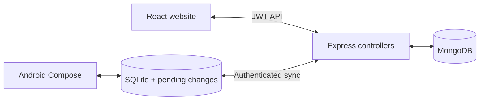

<div align="center">

# TRACKER
### Make a plan. Keep a promise. See your progress.

A personal workspace for the work you want to finish—and the habits you want to keep.

[Open TRACKER](https://tracker-rw9d.onrender.com/) · [Get the Android app](https://github.com/Aikansh-Official/TRACKER/releases/tag/android-v2.1.1) · [Report an issue](https://github.com/Aikansh-Official/TRACKER/issues)


</div>

## One place to turn intention into action

“Study more” is hard to measure. **Solve 5 questions** gives you a finish line. Add the task, choose its day, and watch 0/5 become 5/5. TRACKER keeps your plan, routines, and progress together without inventing a history for you.

| Your space | What you can do |
|---|---|
| **Overview** | See today's tasks, completion, streaks, monthly trends, category comparisons, activity map, and routine history. Insights live here. |
| **Plan** | Switch between day, week, and month; create one-time or measurable tasks; edit, reschedule, and track progress. |
| **Routines** | Build repeatable habits with targets, schedules, and an archive. |
| **Mood** | Record mood, energy, stress, focus, sleep, and reflection. |
| **Pending & Archive** | Find unfinished work and restore routines when you need them again. |
| **About** | Find support, source code, and Android downloads. |

Use the floating **Sync** button to refresh tasks, routines, mood, and Overview from your account. Website edits save automatically; the button reports refresh failures and supports retry. Reminders are accessible inside Plan.

Inside Plan, expand **Focus, goals, and reflection** for focus sessions, milestones, daily intentions, and weekly reviews. Events, recurrence, checklists, reminders, JSON export, and calendar export remain available. The web app also supports installation as a PWA.

## Your phone works offline

The [native Android companion](https://github.com/Aikansh-Official/TRACKER-Kotlin-) saves edits to SQLite first. Use Sync now or select a daily time to exchange updates with the website using the same account. Explicit sign-in imports the account once; edits and reopening the app do not start sync. Pending edits survive restarts; conflicting task edits ask you which version to keep.

[Download Android 2.1.1](https://github.com/Aikansh-Official/TRACKER/releases/download/android-v2.1.1/TRACKER-Kotlin-release.apk) · [Checksums and installation](downloads/android/README.md)

The APK is a directly distributed portfolio build signed with the existing Android debug key, not a Google Play release. Android 8.0 or later is required. Older Flutter/Kotlin builds use a legacy sync protocol; upgrade to the current native app before syncing with this backend.

## Run locally

Use Node.js 22 or newer and MongoDB Community Server (or your own Atlas database).

```bash
npm ci
cp .env.example .env
# Set JWT_SECRET to a long random value. Set MONGODB_URI for your database.
npm run dev:full
```

On PowerShell, use `Copy-Item .env.example .env`. The startup helper reuses local MongoDB or starts an installed local server. Open the Vite URL printed in the terminal (usually `http://localhost:5173`). The API defaults to port 5000.

For a single server serving the built website and API:

```bash
npm start
```

Check `/api/health` for API/database readiness. Never commit `.env` or database credentials.

## How it fits together



- **Web:** React + Vite; shared navigation, Overview analytics, and a unified Plan page.
- **API:** Express + Mongoose; user-scoped data, task validation, soft deletion, and revision-aware sync.
- **Android:** Kotlin + Jetpack Compose + SQLite; local edits, durable pending changes, manual sync, and optional scheduled daily sync.
- **Optional AI:** server-side, opt-in suggestions grounded in a small set of the signed-in user's recent records. Disabled by default; requires `AI_ENABLED`, `AI_MODEL`, and `OPENAI_API_KEY`. No key is bundled in the clients.

```text
src/                 Website pages, components, styles, and API client
server/controllers/  Task and sync request handlers
server/routes/       Auth, routines, analytics, mood, and productivity APIs
server/models/       MongoDB data models
server/services/     Validation, migrations, and optional suggestion retrieval
tests/               API-cache, validation, and local MongoDB integration checks
docs/                Learning guide, design notes, and verification evidence
```

## Verify and deploy

```bash
node server/ensureMongo.js
npm test
npm run build
```

The integration tests use the separate local `tracker_simplification_test` database. See [verification details](docs/VERIFICATION.md) for what was checked and the remaining limits. For a guided explanation of the architecture, start with the [learning guide](docs/LEARNING-GUIDE.md).

Render serves the frontend and API from the same URL. Connect this repository's `main` branch, use `npm ci && npm run build` as the build command, `node server/server.js` as the start command, and `/api/health` as the health check. Set `MONGODB_URI`, `JWT_SECRET`, and `CLIENT_ORIGIN` in Render; keep the existing production database when updating. Enable auto-deploy for new commits. Existing services using `npm start` also work.

## Honest boundaries

Web access needs the server; offline editing is implemented in the Android app. Android defaults to manual sync and offers an optional daily time. Scheduled work waits for connectivity; Android battery restrictions and Render free-service cold starts can delay completion. Task conflicts use revisions; competing routine/mood edits for the same date use last-successful-upload-wins. Live AI generation requires provider configuration and has not been validated in this release's local checks.

## Built by Aikansh Katiyar

Built to make everyday progress visible—and to explore practical full-stack engineering through real persistence, offline state, and synchronization.

[GitHub](https://github.com/Aikansh-Official) · [LinkedIn](https://www.linkedin.com/in/aikansh-katiyar-975663305/) · [Email](mailto:aikanshkatiyar@gmail.com)

Ideas and bug reports are welcome in [Issues](https://github.com/Aikansh-Official/TRACKER/issues). Include the steps, expected result, and what happened.
