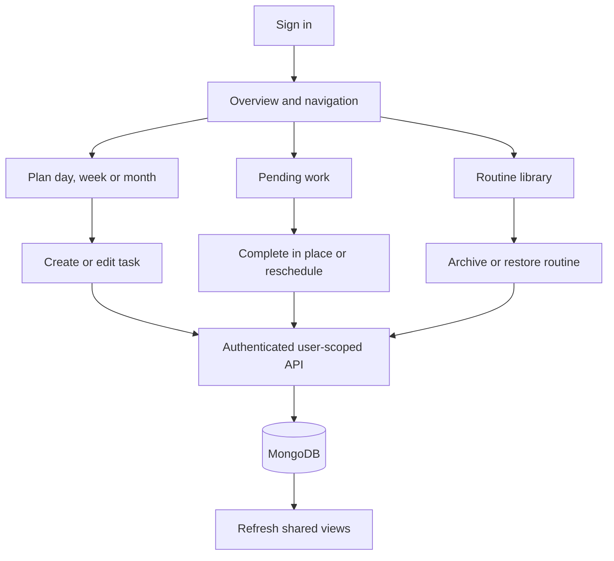
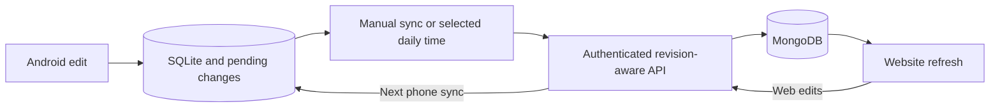

# Current user and data flows

See [LEARNING-GUIDE.md](LEARNING-GUIDE.md) for architecture, models, endpoints and folder responsibilities.

Explicit phone sign-in imports once. Website editing needs network access; offline editing is implemented on Android. A sync failure keeps phone changes pending. Task revision conflicts require an explicit choice; routine/mood competing updates retain last-successful-upload-wins behavior.
